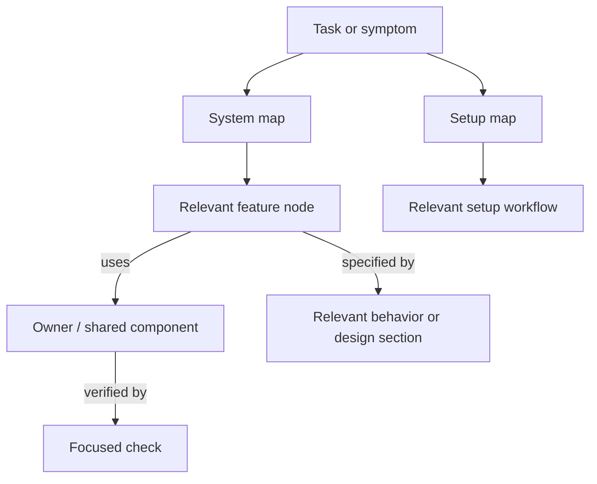

# Task-to-document map

Updated: 2026-10-04. Start with the row closest to the task; read one feature node and follow only relevant edges.

| Task | Entry |
| --- | --- |
| Header notifications, new-hire confirmation reminders or probation day 45/90/119 | [SYS-PLATFORM F28](maps/system/platform.md#f28-shared-notification-center-and-recruiter-reminders) → [SYS-RECORDS F11](maps/system/records.md#f11-new-hire-start-confirmation-offer-reassignment-and-status-refresh) → [canonical behavior](WEBSITE_STRUCTURE.md#recruitment-workflows) → [focused E2E](../tests/e2e/notification-center.spec.ts) |
| Records adaptive 48px rows, triangle sorting, all-matching capture/export, Requisition identity or complete Stage history | [Records owners](maps/system/records.md#records-density-and-fixed-size-pages) → [shared contract](design/controls.md#records-tables-and-fixed-pagination) / [detail owners](maps/system/pipeline.md#flat-detail-and-records-table-refinement) → [checks](../tests/e2e/records-refinement.spec.ts) |
| Records staged filter sidebar, list styling and candidate history workbook | [Contract](WEBSITE_STRUCTURE.md#candidate-registry-column-filters-and-selection) → [Records owners](maps/system/records.md) → [export](../src/lib/candidate-full-export.ts) / [sidebar checks](../tests/e2e/records-filter-actions.spec.ts) / [list design](../tests/e2e/records-filter-list-design.spec.ts) / [export checks](../tests/e2e/records-divider-filters.spec.ts) |
| Structural skeletons, five-card boards, compact offers or sourcing repair | [Design adjustment record](work-items/design-adjustments/implementation.md#november-3-refinement) → follow only the affected canonical contract |
| Create/add a feature; choose direct or agent work | [Feature delivery process](workflows/FEATURE_DELIVERY_LOOP.md) |
| Change behavior, component or record flow | [System map](maps/SYSTEM_MAP.md) |
| Run locally, configure services, schema workflow or release | [Setup map](maps/SETUP_MAP.md) |
| Home banner, summary, calendar or Recruitment Records tables | [SYS-HOME F10/F11](maps/system/home.md#f10-home-metrics-recruitment-events-calendar-and-tabbed-records) → [Home design](design/home.md#recruitment-records) → [Home tests](../tests/e2e/home-candidate-pipeline.spec.ts) |
| Workspace picker, linked-requisition popup, selected header or tabs | [SYS-WORKSPACE F00](maps/system/workspace.md#f00-groups-picker-selected-group-header-journey-and-tabs) → [picker](design/workspace.md#picker-at-workspace) / [header](design/workspace.md#selected-case-header-and-section-navigation) → [Workspace tests](../tests/e2e/workspace.spec.ts) |
| Workspace Overview journey or data quality | [SYS-WORKSPACE sections](maps/system/workspace.md#f00-section-presentation-search-keys) → [Overview design](design/workspace.md#overview) → [Workspace tests](../tests/e2e/workspace.spec.ts) |
| Workspace Sourcing summary, donut, stage bars, week list or editor | [SYS-WORKSPACE Sourcing](maps/system/workspace.md#f00-section-presentation-search-keys) → [Sourcing design](design/workspace.md#sourcing-pipeline-offer-activity) → [Workspace tests](../tests/e2e/workspace.spec.ts) |
| Audit Log filters, actor, table or field changes | [SYS-RECORDS F30](maps/system/records.md#f30-audit-log-presentation) → [design](design/audit.md) → [focused test](../tests/e2e/ux-enhancements.spec.ts) |
| Requisition Detail drawer | [SYS-RECORDS](maps/system/records.md) → [Requisition Detail design](design/requisition-detail.md) |
| Candidate drawer profile/note layout, connected tabs or lifetime group uniqueness | [SYS-PIPELINE refinement](maps/system/pipeline.md#connected-profile-and-group-uniqueness) → [contract](design/candidate-detail.md#connected-drawer-refinement) |
| Candidate form identity, prefill reset, in-list group search, masked pool, profile note or application tabs | [SYS-PIPELINE privacy/layout](maps/system/pipeline.md#creator-privacy-and-profileapplication-layout) → [contract](design/candidate-detail.md#shared-profile-and-application-tabs) → [checks](../tests/e2e/candidate-profile-redesign.spec.ts) |
| Talent pool profiles, parallel applications or reassignment | [SYS-PIPELINE owners](maps/system/pipeline.md#independent-profile-and-application-ownership) → [behavior](WEBSITE_STRUCTURE.md#independent-candidate-profiles) → [feature evidence](work-items/independent-candidate-applications/implementation.md) |
| Workspace Table/Cards preference | [SYS-WORKSPACE views](maps/system/workspace.md#picker-views-and-reusable-profiles) → [contract](design/workspace.md#group-picker-view-preference) → [checks](../tests/e2e/candidate-applications.spec.ts) |
| Candidate Detail delete action or record-candidate group labels | [SYS-PIPELINE deletion and group labels](maps/system/pipeline.md#candidate-deletion-and-application-group-labels) → [design contract](design/candidate-detail.md#candidate-deletion-and-application-group-labels) → [checks](../tests/e2e/candidate-profile-redesign.spec.ts) |
| Candidate profile, journey or stage activity | [SYS-PIPELINE](maps/system/pipeline.md) → [Candidate design](design/candidate-detail.md) |
| Rejection dashboard, compact spacing, treemap/Bars, Saturday–Friday trends, failure reasons or exports | [SYS-REPORTING Rejections](maps/system/reporting.md#rejection-analytics) → [design](design/dashboard-rejections.md) → [focused checks](../tests/e2e/rejection-dashboard.spec.ts) |
| Fail Candidate reasons, Configuration catalog controls or refresh | [SYS-PIPELINE F22](maps/system/pipeline.md#f22-candidate-pipeline-boardrecord-register) → [Pipeline behavior](WEBSITE_STRUCTURE.md#recruitment-workflows) → [catalog test](../tests/e2e/rejection-reason-admin.spec.ts) |
| Performance/Pipeline Excel export, compact summary/source sheets or format chooser | [SYS-REPORTING exports](maps/system/reporting.md#dashboard-data-exports) → [export contract](design/dashboard-data-export.md) → [workbook checks](../tests/e2e/dashboard-data-export.spec.ts) |
| Compact Dashboard buttons/sidebar/report density | [SYS-REPORTING compact presentation](maps/system/reporting.md#compact-dashboard-presentation) → [portal](design/dashboard-portal.md#compact-system-presentation) / [Controls](design/controls.md#fields-buttons-and-overlays) → [compact checks](../tests/e2e/dashboard-compact.spec.ts) |
| Dashboard navigation, square bars, summary fractions, SLA restart annotations | [SYS-REPORTING refinement](maps/system/reporting.md#dashboard-navigation-and-summary-refinement) → [portal](design/dashboard-portal.md) / [Risk summaries](design/dashboard-risk-bottlenecks.md#summary-refinement) → [refinement checks](../tests/e2e/dashboard-refinement.spec.ts) |
| Dashboard common filters, tabs, URL/session state | [SYS-REPORTING](maps/system/reporting.md#common-dashboard-portal) → [portal design](design/dashboard-portal.md) → [portal checks](../tests/e2e/dashboard-portal.spec.ts) |
| Vacancy Risk / Aging, Stage Bottlenecks, historical deadlines, normalized attempts or their exports | [SYS-REPORTING subviews](maps/system/reporting.md#risk-and-bottleneck-subviews) → [design](design/dashboard-risk-bottlenecks.md) → [workbooks](design/dashboard-data-export.md#risk-and-bottleneck-workbooks) → [focused checks](../tests/e2e/dashboard-risk-bottlenecks.spec.ts) |
| Stage screen-only KPI removal / white warning banner | [Reporting](maps/system/reporting.md#stage-screen-and-png-refinement) → [Stage layout](design/dashboard-risk-bottlenecks.md#stage-layout) → [checks](../tests/e2e/stage-mobile-refinement.spec.ts) |
| Mobile three-item navigation, Records sheet/tablet breakpoint, desktop-required pages | [Platform F06](maps/system/platform.md#f06-phone-first-recruiter-operations) → [Mobile contract](design/mobile-navigation.md) → [checks](../tests/e2e/mobile-operations.spec.ts) |
| Configuration folders, search, contextual reason/template editors | [SYS-PIPELINE](maps/system/pipeline.md#configuration-browser) → [folder design](design/configuration.md) → [catalog checks](../tests/e2e/rejection-reason-admin.spec.ts) |
| Waterfall/requisition export, Pipeline Health layout, Source details or PNG | [SYS-REPORTING F04](maps/system/reporting.md#f04-dashboard-report-views-exports-and-xlsx) → [Dashboard behavior](WEBSITE_STRUCTURE.md#dashboard-page) → [dashboard test](../tests/e2e/dashboard-reports.spec.ts) |
| Date selector or dropdown | [Control contract](design/controls.md) → [SYS-PLATFORM](maps/system/platform.md) |
| Shared type/color hierarchy | [Foundations](design/foundations.md) → affected system node |

## Graph reading rule

Nodes are feature owners, shared components, contracts and setup workflows. Edges name relationships: `uses`, `reads`, `opens`, `embeds`, `invokes`, `updates`. Follow the shortest relevant path from the symptom to its owner; do not walk the entire graph. Reverse edges identify consumers to check after a shared change.

Stop expanding once the owner, relevant contract and verification target are identified. Cycles such as Workspace → Records → Workspace represent navigation, not instructions to reread nodes; visit each node at most once per investigation unless new evidence requires it.

Keep one owner for each rule. Maps contain links/search keys, not copied policy. Update a feature's node when ownership changes and update its impact back-links when dependencies change. Shared nodes with many consumers deserve caller inspection; they do not require all documentation to be loaded.

Validate maintained links and graph structure with `python scripts/check_agent_docs.py`. The current feature inventory is F00–F28 across seven nodes; when intentionally extending the graph, update its expected inventory in the checker with the map. [Verification boundaries](workflows/TEST_ENVIRONMENTS.md) distinguish structural validation from application behavior tests.

Find symbols quickly: `rg -n "DayDateSelector|CandidateDetailHeader" docs/maps docs/design src` from the app checkout. Do not treat sibling checkouts or archived documentation as the active source.

Candidate/requisition form refinement: `src/components/RecruitmentWorkspace.tsx`, `src/components/requisitions/AuthorizedRequisitionLookup.tsx`; layout contracts: [candidate detail](design/candidate-detail.md), [requisition detail](design/requisition-detail.md), [selector controls](design/controls.md). Focused checks: candidate-search-outcomes and requisition-identity browser specs.

Pipeline card name/group/metadata layout: [F22](maps/system/pipeline.md#f22-candidate-pipeline-boardrecord-register) → [contract](design/pipeline.md#candidate-card-hierarchy) → [owner](../src/components/pipeline/PipelineBoardView.tsx) → [focused checks](../tests/e2e/pipeline-card-layout.spec.ts).
